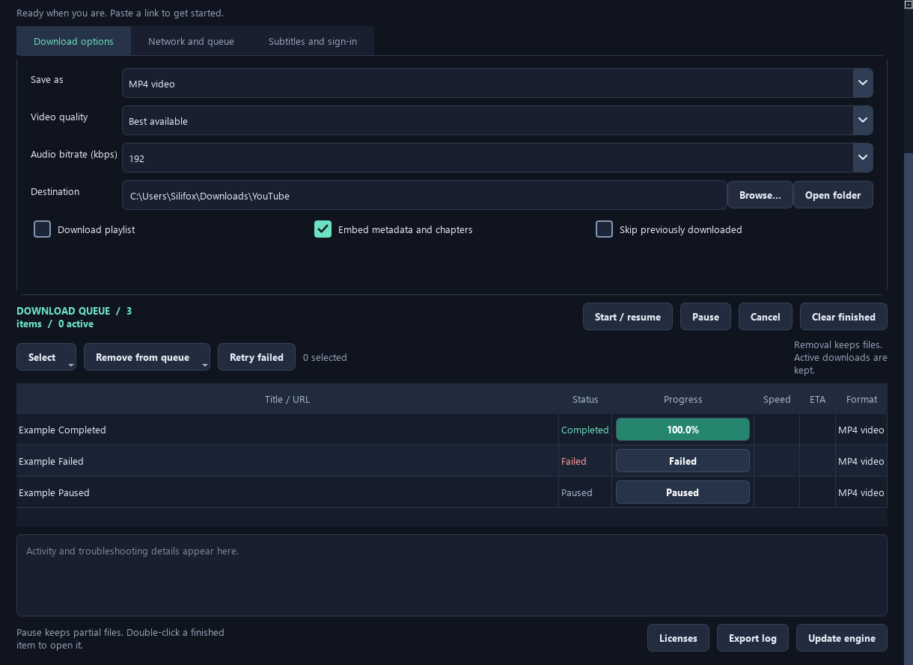

# YouTube Downloader Studio

A desktop video and audio downloader built with Python, PySide6, and yt-dlp. Manage a persistent download queue, choose formats and quality per job, and package the app with its download tools for standalone use.



## Highlights

- **Video and audio:** MP4 and MKV video; MP3, M4A, FLAC, and WAV audio. Choose the best available video or a resolution ceiling from 360p to 2160p.
- **A queue you control:** batch URLs, playlists and item ranges, concurrent jobs, pause/resume, cancellation, retries, and persistent history.
- **Bulk actions:** select by status, invert selections, retry failed jobs, and remove queue entries while keeping downloaded files.
- **Live progress:** percentage, speed, ETA, and a finalizing state during post-processing.
- **Download options:** subtitles, automatic captions, language patterns, thumbnails, metadata, chapters, bandwidth limits, parallel fragments, and proxies.
- **Separate quality versions:** filenames and duplicate tracking distinguish format, requested quality, and destination.
- **Optional authentication:** use an explicitly selected browser or Netscape-format cookies file when required by the source.
- **Standalone packaging:** bundle Python, Qt, yt-dlp, Deno, FFmpeg, and FFprobe; update yt-dlp independently from the interface.

## Platform support

| Platform | Build path | Notes |
| --- | --- | --- |
| Windows 10/11, 64-bit | PowerShell build scripts | Primary desktop implementation; folder and single-file builds |
| Linux | `portable/build.sh` | Native executable; requires compatible desktop libraries and glibc |
| macOS | `portable/build.sh` | Separate Apple Silicon and Intel app bundles; signing/notarization are separate steps |

Linux and macOS use a native adapter around the shared GUI. See [native platform documentation](portable/README.md) for dependencies, architecture details, verification, and distribution limitations. Availability of a build script does not imply that every platform has been validated.

## Get started on Windows

This repository contains source code and build scripts. Generated executables and third-party runtime binaries are excluded from Git; the paths below are local build outputs, not preinstalled files.

### 1. Clone and install Python dependencies

Use 64-bit Python 3.11 or 3.12 and run these commands in PowerShell:

```powershell
git clone https://github.com/farshid1996/youtube_downloader.git
cd youtube_downloader
python -m venv .venv
.\.venv\Scripts\python.exe -m pip install -r requirements.txt
```

### 2. Prepare the download tools

Place Windows executables for the following tools in `vendor/`:

```text
vendor/
  yt-dlp.exe
  deno.exe
  ffmpeg.exe
  ffprobe.exe
```

Alternatively, place `ffmpeg.exe` and `ffprobe.exe` in `C:\bin`, then run the preparation helper from the project root:

```powershell
New-Item -ItemType Directory -Force vendor | Out-Null
.\.venv\Scripts\python.exe prepare_tools.py
```

The helper downloads yt-dlp and Deno from their official GitHub releases and copies the two FFmpeg executables from `C:\bin`. It requires network access and does not install FFmpeg for you.

### 3. Launch

```powershell
.\.venv\Scripts\python.exe main.py
```

## Using the app

1. Paste one complete HTTP or HTTPS URL per line.
2. Choose a format, quality, and destination. Enable playlists or additional options if needed.
3. Select **Download now** to start, or **Add to queue** to save paused jobs.
4. Select rows to start/resume, pause, or cancel them. With no selection, these controls apply to all eligible jobs.
5. Double-click a completed row to open its output, or right-click for file, folder, source, retry, and queue actions.

The **Select** and **Remove from queue** menus support status-based batch operations. Removing a queue entry keeps its media files and protects running jobs. **Retry failed** retries all failed entries without changing the other jobs.

Pause stops the downloader process tree and keeps partial files. Resume restarts yt-dlp with continuation enabled; continuation depends on the source protocol and server. Conversion may need to restart. Cancel also keeps existing media and partial files.

Quality labels such as `[mp4-1080p]` indicate the requested maximum resolution. The actual source may have a lower resolution. Converting to FLAC or WAV cannot restore information missing from the original audio.

## Build a Windows executable

Prepare `vendor/` and the Python environment first, then choose a build:

```powershell
# Folder distribution
.\build.ps1

# Single-file distribution
.\build-single.ps1
```

| Build | Output |
| --- | --- |
| Folder | `dist/YouTubeDownloader/YouTubeDownloader.exe` |
| Single file | `dist/single/YouTubeDownloader.exe` |

Share the entire folder for a folder build. The single-file build embeds the application and tools; the destination machine does not need a separate Python, FFmpeg, or Deno installation.

Build scripts generate `tools.zip` and a SHA-256 manifest. On first launch, a packaged Windows app extracts its tools into per-user storage, checks their integrity, and restores missing or damaged files. An explicitly successful engine update is preserved. Allow disk space for both the extracted application runtime and its tools.

Review [third-party notices](THIRD_PARTY_NOTICES.txt) and the relevant component licenses before redistributing a packaged build.

## Linux and macOS builds

On the target operating system, with Python 3.11 or 3.12 installed:

```sh
bash portable/build.sh
bash portable/check.sh
```

See [portable/README.md](portable/README.md) for full setup instructions. The manually triggered [native build workflow](.github/workflows/native-desktop.yml) builds Linux x64 and both macOS architectures and uploads build artifacts. It does not automatically publish GitHub releases.

## Data and privacy

| Platform | Application data |
| --- | --- |
| Windows | `%LOCALAPPDATA%\YouTubeDownloaderStudio` |
| Linux | `$XDG_DATA_HOME/YouTubeDownloaderStudio`, or `~/.local/share/YouTubeDownloaderStudio` |
| macOS | `~/Library/Application Support/YouTubeDownloaderStudio` |

Settings, queue history, download archives, and extracted tools use application storage. Media is saved to the destination you choose.

Proxy settings and cookie selections are not persisted in saved settings or queue entries. Reselect them before resuming authenticated jobs after a restart. Cookie access is opt-in; browser encryption or locking can prevent extraction. Proxy and cookie arguments may be visible to local administrative process-inspection tools. Review exported activity logs before sharing them.

## Verification

With the Windows dependencies and `vendor/` tools installed:

```powershell
.\.venv\Scripts\python.exe -m pytest tests -q
```

The suite covers argument construction, URL validation, tool repair, local video downloads and audio conversion, quality-specific output, GUI queue behavior, and bulk actions. Integration tests generate synthetic media and serve it on localhost; they do not require browser cookies or a successful YouTube download.

After building the single-file executable:

```powershell
.\verify-single.ps1
```

This checks the copied executable with isolated application storage and a system-only PATH. Historical verification details and known testing limits are recorded in [TEST_RESULTS.md](TEST_RESULTS.md).

## Troubleshooting

| Symptom | What to check |
| --- | --- |
| Missing tool or preparation failure | Confirm all four executables are in `vendor/` for source runs. For packaged runs, check disk space and security-software quarantine. |
| YouTube asks you to sign in or reports a bot check | Update the engine. Where appropriate, explicitly select cookies for an account permitted to access the media. Authentication is not guaranteed to resolve restrictions. |
| Download stops at 100% briefly | Audio/video merging, conversion, or metadata processing may still be running. Wait for the completed state. |
| Resuming starts part of the work again | The source may not support continuation, or post-processing may need to restart. |
| A repeated download is skipped | Check the output files and optional archive. Duplicate tracking is separated by format, quality, and destination. |

Source services can change behavior, require authentication, or impose region and availability restrictions. No downloader can guarantee access to every URL.

## Project layout

```text
main.py                  PySide6 interface and queue management
engine.py                Downloader arguments, storage, and bundled tools
assets/                  Interface icons
prepare_tools.py         Windows tool preparation helper
package_tools.py         Tool payload and SHA-256 manifest generation
build*.ps1               Windows packaging scripts
verify-single.ps1        Standalone Windows verification
portable/                Linux/macOS adapter, packaging, and tests
tests/                   Application and integration tests
.github/workflows/       Manually dispatched native builds
```

## Contributing

For bug reports, include your OS, Python or packaged-app version, steps to reproduce, and a redacted error message. Keep cookies, credentials, signed URLs, and private media out of reports. For code changes, describe the behavior being changed and run the relevant tests.

## Licensing and responsible use

No project-wide license has been declared in this repository. Third-party components retain their own licenses; see [THIRD_PARTY_NOTICES.txt](THIRD_PARTY_NOTICES.txt). Do not assume those licenses grant rights to this project's original code.

Download only media you are entitled to save and follow the source service's applicable terms. DRM-protected media is not supported.
