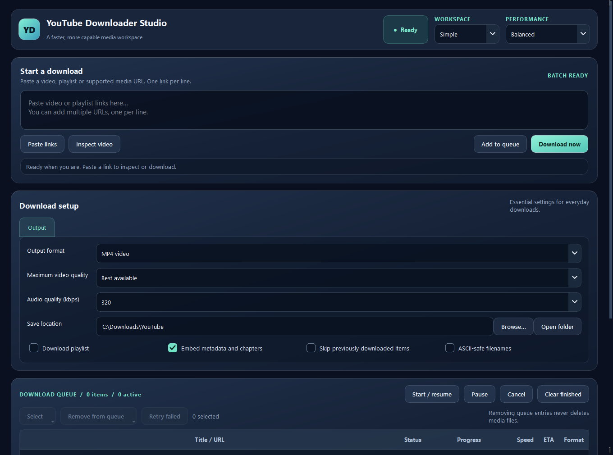
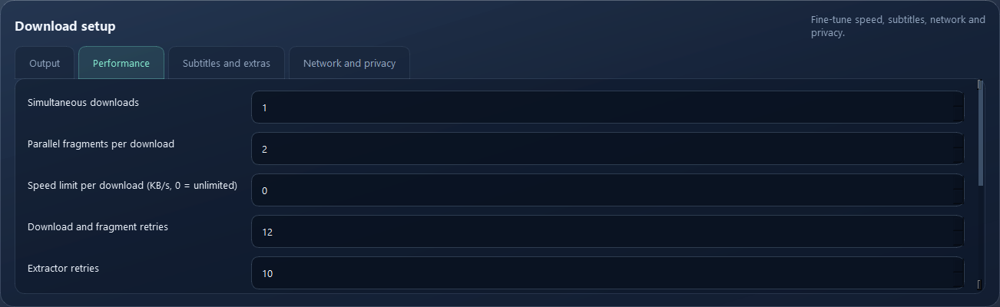
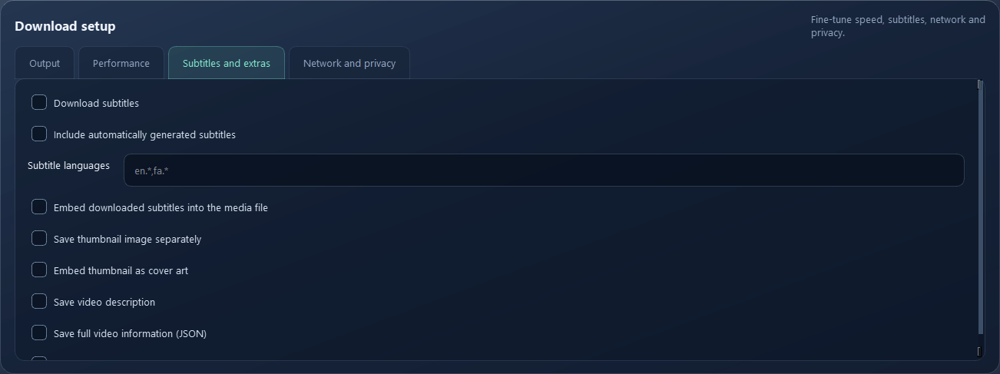
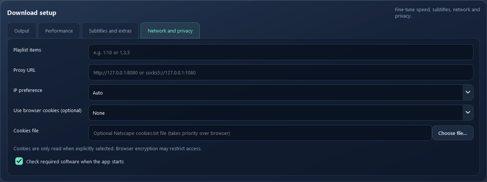
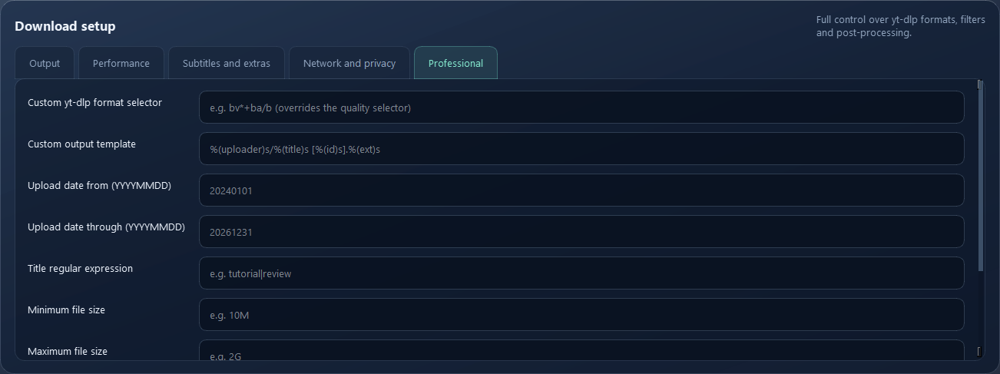
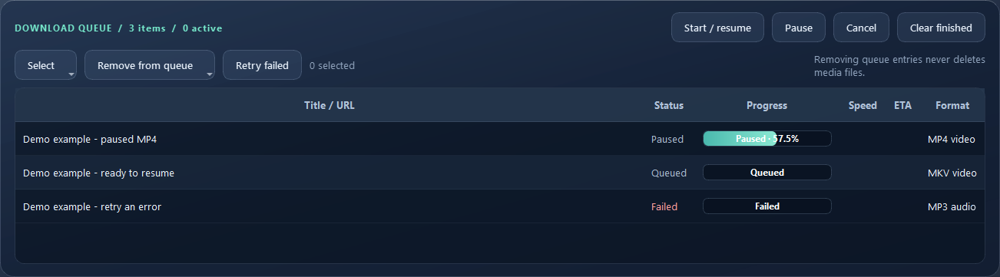
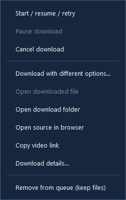
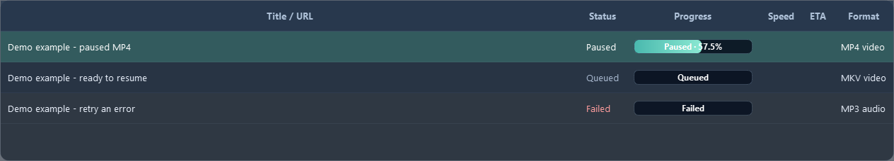
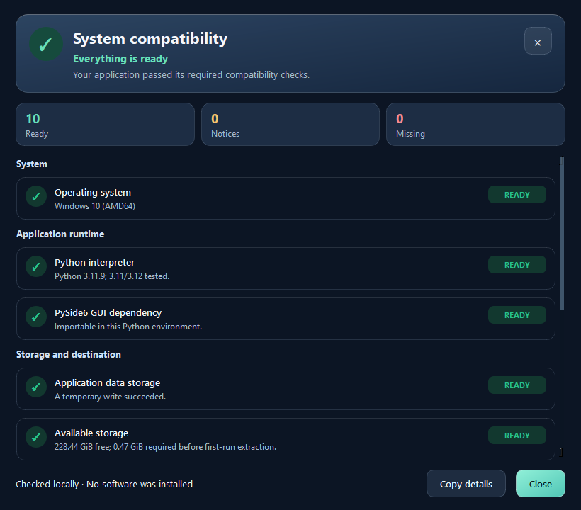

# YouTube Downloader Studio

A desktop video and audio downloader built with Python, PySide6, and yt-dlp. Manage a persistent download queue, choose formats and quality per job, and package the app with its download tools for standalone use.



## Download

**[Download the latest release](https://github.com/farshid1996/youtube_downloader/releases/latest)** — packaged builds include Python, Qt, yt-dlp, Deno, FFmpeg, and FFprobe. No separate Python or download-tool installation is needed.

### Current Windows release: v1.1.0

| Platform | Download | Status |
| --- | --- | --- |
| Windows 10/11 x64 | [Standalone Studio EXE](https://github.com/farshid1996/youtube_downloader/releases/download/v1.1.0/YouTubeDownloader-Studio-v1.1.0-windows-x64.exe) | Current v1.1.0 |
| Linux x64 | [Historical v1.0.0 package](https://github.com/farshid1996/youtube_downloader/releases/tag/v1.0.0) | Older version; not the current Studio build |
| macOS | [Build from source](portable/README.md) | No prebuilt v1.1.0 release |

**Windows:** download the executable, verify its SHA-256 against the release checksum file, then run it. Python, Qt, yt-dlp, Deno, FFmpeg and FFprobe are bundled. Allow time and space for first-run extraction. The app is unsigned and may trigger an OS reputation warning.

**Verify:** Run PowerShell Get-FileHash on the downloaded EXE using -Algorithm SHA256 and compare with [SHA256SUMS.txt](https://github.com/farshid1996/youtube_downloader/releases/download/v1.1.0/SHA256SUMS.txt). See the release verification report and third-party notices before redistribution.

The latest Linux and macOS versions must be built and tested separately using [portable/README.md](portable/README.md).

## Highlights

- **Video and audio:** MP4 and MKV video; MP3, M4A, FLAC, and WAV audio. Choose the best available video or a resolution ceiling from 360p to 2160p.
- **A queue you control:** batch URLs, playlists and item ranges, concurrent jobs, pause/resume, cancellation, retries, and persistent history.
- **Bulk actions:** select by status, invert selections, retry failed jobs, and remove queue entries while keeping downloaded files.
- **Live progress:** percentage, speed, ETA, and a finalizing state during post-processing.
- **Three workspace levels:** Simple for everyday downloads, Advanced for performance/network/subtitle controls, and Professional for detailed yt-dlp configuration.
- **Performance profiles:** Balanced, Maximum speed, Maximum reliability, and Data saver coordinate simultaneous jobs, fragment concurrency, retry policy, request delays and chunk size.
- **Professional controls:** custom yt-dlp format selectors and output templates, date and file-size filters, title regular expressions, extractor arguments, SponsorBlock, metadata, comments, embedded subtitles and cover art.
- **Download options:** subtitles, automatic captions, language patterns, thumbnails, metadata, chapters, bandwidth limits, parallel fragments, proxies and IPv4/IPv6 preference.
- **Modern interface:** Liquid Glass-inspired layered panels, Windows Mica/dark title-bar effects where supported, subtle entrance/progress motion, keyboard shortcuts and a grouped compatibility dialog.
- **Queue responsiveness:** progress events are coalesced and only dirty rows are repainted. On this Windows development machine, the local 1,000-row UI benchmark measured a 65.30 ms full render and a 0.187 ms single-row update; this measures UI rendering, not download throughput.
- **Separate quality versions:** filenames and duplicate tracking distinguish format, requested quality, and destination.
- **Optional authentication:** use an explicitly selected browser or Netscape-format cookies file when required by the source.
- **Standalone packaging:** bundle Python, Qt, yt-dlp, Deno, FFmpeg, and FFprobe; update yt-dlp independently from the interface.

## Platform support

| Platform | Build path | Notes |
| --- | --- | --- |
| Windows 10/11, 64-bit | PowerShell build scripts | Primary desktop implementation; folder and single-file builds |
| Linux | `portable/build.sh` | Native executable; requires compatible desktop libraries and glibc |
| macOS | `portable/build.sh` | Separate Apple Silicon and Intel app bundles; signing/notarization are separate steps |

Linux and macOS use a native adapter around the shared GUI. See [native platform documentation](portable/README.md) for dependencies, architecture details, verification, and distribution limitations. Availability of a build script does not imply that every platform has been validated.

## Run from source on Windows

This repository contains source code and build scripts. Generated executables and third-party runtime binaries are excluded from Git; the paths below are local build outputs, not preinstalled files.

### 1. Clone and install Python dependencies

Use 64-bit Python 3.11 or 3.12 and run these commands in PowerShell:

```powershell
git clone https://github.com/farshid1996/youtube_downloader.git
cd youtube_downloader
python -m venv .venv
.\.venv\Scripts\python.exe -m pip install -r requirements.txt
```

### 2. Prepare the download tools

Place Windows executables for the following tools in `vendor/`:

```text
vendor/
  yt-dlp.exe
  deno.exe
  ffmpeg.exe
  ffprobe.exe
```

Alternatively, place `ffmpeg.exe` and `ffprobe.exe` in `C:\bin`, then run the preparation helper from the project root:

```powershell
New-Item -ItemType Directory -Force vendor | Out-Null
.\.venv\Scripts\python.exe prepare_tools.py
```

The helper downloads yt-dlp and Deno from their official GitHub releases and copies the two FFmpeg executables from `C:\bin`. It requires network access and does not install FFmpeg for you.

### 3. Launch

```powershell
.\.venv\Scripts\python.exe main.py
```

## Visual walkthrough

All screenshots below were captured directly from the running **Windows desktop application using native Qt rendering** (not offscreen mode or generated mockups). Text, labels, and controls are rendered using the system's real Segoe UI font. For safety, example URLs and queue entries are illustrative; no media was downloaded for these screenshots. Some features depend on the media source and available codecs.

### 1. Start in Simple workspace


Paste one or more authorized media URLs, select MP4 or an audio format, choose a quality and destination, then choose **Inspect video**, **Download now**, or **Add to queue**. If the source offers less than the selected quality, the app cannot invent missing resolution.

### 2. Add links and inspect before downloading


Use a complete HTTP(S) URL on each line. Inspect to review metadata where the source makes it available. You can stage work in the persistent queue before starting; successful downloads go to your chosen destination, not inside the application folder.

### 3. Explore Advanced controls



Advanced settings include performance, network and media-processing controls. **Maximum speed** favors concurrency while **Maximum reliability** reduces aggressiveness and increases retries. Use conservative settings on rate-limited sites or unstable connections.

**Subtitles and extras:** download or embed subtitles, thumbnails, metadata, descriptions and other supported details.



**Network and privacy:** customize IP preference, optional proxy configuration and explicitly selected browser/cookie settings.



### 4. Customize Professional options



Professional mode exposes additional yt-dlp features such as custom format selection, output templates, upload-date and file-size filters. Invalid dates, unsupported format expressions and unsafe output paths may cause jobs to fail; test one URL before large batches.

### 5. Manage the queue and downloads



Select one or more jobs to pause, resume, retry or cancel. The **Select** and **Remove from queue** menus support bulk actions and status filters. Queue deletion retains downloaded media; pause/resume keeps partial files where the site supports continuation.



Right-click an entry for its available file, folder, URL, retry and queue actions. Failed entries can be retried without touching successful ones.

### 6. Monitor transfer progress



The queue displays progress and download state (illustrative entries appear in the screenshot; no download was started to capture it). Media merges, subtitle processing and audio conversion may continue after the network transfer completes. A progress indicator alone does not mean a file is ready.

### 7. Run the system checker

Use **System check** from the desktop app to inspect required media tools, storage permissions, free space and runtime compatibility. In a standalone Windows build, required tools are bundled; a separate Python installation is unnecessary. Use **Copy details** for a redacted support report and review it before sharing.



### 8. Choose the right download profile

| Need | Suggested configuration | Notes |
| --- | --- | --- |
| Typical single video | Simple + Balanced + MP4 | Start with the default quality |
| Many permitted links | Batch queue + Balanced | Check results and disk space regularly |
| Unreliable connection | Maximum reliability | Resume support varies by server |
| Fast downloads | Maximum speed | Higher concurrency is not always faster |
| Audio files | MP3/M4A/FLAC/WAV | Re-encoding does not improve source fidelity |
| Filtered archives | Professional + date/size filters | Test selectors on one item first |

### Regenerate screenshots (maintainers)

Run `.\.venv\Scripts\python.exe scripts\capture_readme_screenshots.py` in a **native Windows desktop session** with project dependencies installed. The script checks for Windows Qt and Segoe UI before generating screenshots, uses isolated application data, and displays clearly labeled sample queue entries without downloading anything. Avoid `QT_QPA_PLATFORM=offscreen`: it previously created the unreadable square characters seen in older documentation images.

## Using the app

1. Paste one complete HTTP or HTTPS URL per line. Multiple URLs can be processed as a batch.
2. Start in **Simple** workspace for format, quality and destination. Switch to **Advanced** for performance, subtitles and network settings, or **Professional** for custom yt-dlp selectors, output templates, date/size filters and extractor options.
3. Choose a performance profile. **Maximum speed** raises simultaneous jobs and fragment concurrency; actual throughput still depends on the source, network and storage. **Maximum reliability** favors lower concurrency and more retries.
4. Select **Inspect video** to review available media information, **Download now** to start immediately, or **Add to queue** to stage paused jobs.
5. Select rows to start/resume, pause, or cancel them. With no selection, these controls apply to all eligible jobs.
6. Double-click a completed row to open its output, or right-click for file, folder, source, retry, and queue actions.

Keyboard shortcuts: **Ctrl+Enter** starts a download, **Ctrl+Shift+V** pastes links, and **Ctrl+Shift+O** opens the destination folder.

The **Select** and **Remove from queue** menus support status-based batch operations. Removing a queue entry keeps its media files and protects running jobs. **Retry failed** retries all failed entries without changing the other jobs.

Pause stops the downloader process tree and keeps partial files. Resume restarts yt-dlp with continuation enabled; continuation depends on the source protocol and server. Conversion may need to restart. Cancel also keeps existing media and partial files.

Quality labels such as `[mp4-1080p]` indicate the requested maximum resolution. The actual source may have a lower resolution. Converting to FLAC or WAV cannot restore information missing from the original audio.

## Build a Windows executable

Prepare `vendor/` and the Python environment first, then choose a build:

```powershell
# Folder distribution
.\build.ps1

# Single-file distribution
.\build-single.ps1
```

| Build | Output |
| --- | --- |
| Folder | `dist/YouTubeDownloader/YouTubeDownloader.exe` |
| Single file | `dist/YouTubeDownloader-Studio.exe` |

Share the entire folder for a folder build. The single-file build embeds the application and tools; the destination machine does not need a separate Python, FFmpeg, or Deno installation.

Build scripts generate `tools.zip` and a SHA-256 manifest. On first launch, a packaged Windows app extracts its tools into per-user storage, checks their integrity, and restores missing or damaged files. An explicitly successful engine update is preserved. Allow disk space for both the extracted application runtime and its tools.

Review [third-party notices](THIRD_PARTY_NOTICES.txt) and the relevant component licenses before redistributing a packaged build.

## Linux and macOS builds

On the target operating system, with Python 3.11 or 3.12 installed:

```sh
bash portable/build.sh
bash portable/check.sh
```

See [portable/README.md](portable/README.md) for full setup instructions. The manually triggered [native build workflow](.github/workflows/native-desktop.yml) builds Linux x64 and both macOS architectures and uploads build artifacts. It does not automatically publish GitHub releases.

## Data and privacy

| Platform | Application data |
| --- | --- |
| Windows | `%LOCALAPPDATA%\YouTubeDownloaderStudio` |
| Linux | `$XDG_DATA_HOME/YouTubeDownloaderStudio`, or `~/.local/share/YouTubeDownloaderStudio` |
| macOS | `~/Library/Application Support/YouTubeDownloaderStudio` |

Settings, queue history, download archives, and extracted tools use application storage. Media is saved to the destination you choose.

Proxy settings and cookie selections are not persisted in saved settings or queue entries. Reselect them before resuming authenticated jobs after a restart. Cookie access is opt-in; browser encryption or locking can prevent extraction. Proxy and cookie arguments may be visible to local administrative process-inspection tools. Review exported activity logs before sharing them.

## Verification

With the Windows dependencies and `vendor/` tools installed:

```powershell
.\.venv\Scripts\python.exe -m pytest tests -q
```

The suite covers argument construction, URL validation, tool repair, local video downloads and audio conversion, quality-specific output, GUI queue behavior, and bulk actions. Integration tests generate synthetic media and serve it on localhost; they do not require browser cookies or a successful YouTube download.

After building the single-file executable:

```powershell
.\verify-single.ps1
```

This checks the copied executable with isolated application storage and a system-only PATH. Historical verification details and known testing limits are recorded in [TEST_RESULTS.md](TEST_RESULTS.md).

## Troubleshooting

| Symptom | What to check |
| --- | --- |
| Missing tool or preparation failure | Confirm all four executables are in `vendor/` for source runs. For packaged runs, check disk space and security-software quarantine. |
| YouTube asks you to sign in or reports a bot check | Update the engine. Where appropriate, explicitly select cookies for an account permitted to access the media. Authentication is not guaranteed to resolve restrictions. |
| Download stops at 100% briefly | Audio/video merging, conversion, or metadata processing may still be running. Wait for the completed state. |
| Resuming starts part of the work again | The source may not support continuation, or post-processing may need to restart. |
| A repeated download is skipped | Check the output files and optional archive. Duplicate tracking is separated by format, quality, and destination. |

Source services can change behavior, require authentication, or impose region and availability restrictions. No downloader can guarantee access to every URL.

## Project layout

```text
main.py                  PySide6 interface, queue and audit controls
engine.py                Downloader arguments, storage, and bundled tools
system_check.py          Offline runtime dependency and compatibility checks
project_orchestrator.py  14-agent engineering, UX and R&D coordinator
prepare_audit_sources.ps1 Build-time source snapshot for packaged audits
assets/                  Interface icons
prepare_tools.py         Windows tool preparation helper
package_tools.py         Tool payload and SHA-256 manifest generation
build*.ps1               Windows packaging scripts
verify-single.ps1        Standalone Windows verification
portable/                Linux/macOS adapter, packaging, and tests
tests/                   Application and integration tests
.github/workflows/       Manually dispatched native builds
```

## Multi-agent engineering audit and system checks

The project includes a local, read-only engineering orchestrator and an offline
first-launch dependency checker.

### Runtime system check

The desktop app has a **System check** button and a **Check required software
when the app starts** option. The check validates the supported 64-bit OS,
Python/Qt for source runs, bundled yt-dlp/Deno/FFmpeg/FFprobe, app-data and
download-folder write access, free storage, and an optional browser selected
for browser-cookie use. It checks free space before unpacking the embedded
download tools (1.5 GiB recommended for first launch), so a low-space machine
is warned before the large tool payload is extracted.

Packaged builds do not require a separately installed Python, FFmpeg, Deno or
yt-dlp. The checker validates the bundled tools instead. Missing required
components are reported with official information links. The app asks before
opening any link; it never silently downloads or installs software. Optional
browser absence does not block downloads. Results appear in a grouped, scrollable
compatibility dialog with clear Ready / Notice / Action needed states, summary
counts, readable wrapped details, and a Copy details action. Text is rendered
as structured rows rather than one escaped multiline message. Diagnostics are
saved locally to `%LOCALAPPDATA%\\YouTubeDownloaderStudio\\system-check.json`
on Windows.

### Multi-agent orchestrator and R&D

The multi-agent audit and R&D workflow remains available to maintainers
through the command line, but its control is intentionally not displayed in
the end-user desktop interface. The workflow is available through:

```powershell
.\\.venv\\Scripts\\python.exe project_orchestrator.py
.\\.venv\\Scripts\\python.exe project_orchestrator.py --full
.\\.venv\\Scripts\\python.exe project_orchestrator.py --full --online-research
```

Thirteen specialist agents plus an R&D synthesis agent cover architecture,
dependencies, security/privacy, UX research, visual design, interaction/motion,
accessibility, performance engineering, professional workflows, packaging,
cross-platform support and quality assurance. The design agents check the
progressive-disclosure modes, Liquid Glass-inspired design tokens, native
window-close behavior, keyboard interaction, animation and queue-rendering
performance. The R&D agent separates verified findings from hypotheses and
creates a prioritized completion roadmap.

The standalone Windows executable includes the audit source snapshot and the
test runner, so the audit does not require a separate Python installation.
Reports are saved under
`%LOCALAPPDATA%\\YouTubeDownloaderStudio\\reports` on Windows:
`orchestrator-report.json`, `RD_ROADMAP.md`, `UI_UX_DESIGN_SYSTEM.md`,
and `UI_PERFORMANCE_BENCHMARK.md`. During a packaged audit, the regression suite and
synthetic-media/tool verification run locally. Online research contacts
official upstream APIs only; project source, queue, cookies, and download
history are not uploaded.


## Contributing

For bug reports, include your OS, Python or packaged-app version, steps to reproduce, and a redacted error message. Keep cookies, credentials, signed URLs, and private media out of reports. For code changes, describe the behavior being changed and run the relevant tests.

## Licensing and responsible use

No project-wide license has been declared in this repository. Third-party components retain their own licenses; see [THIRD_PARTY_NOTICES.txt](THIRD_PARTY_NOTICES.txt). Do not assume those licenses grant rights to this project's original code.

Download only media you are entitled to save and follow the source service's applicable terms. DRM-protected media is not supported.
